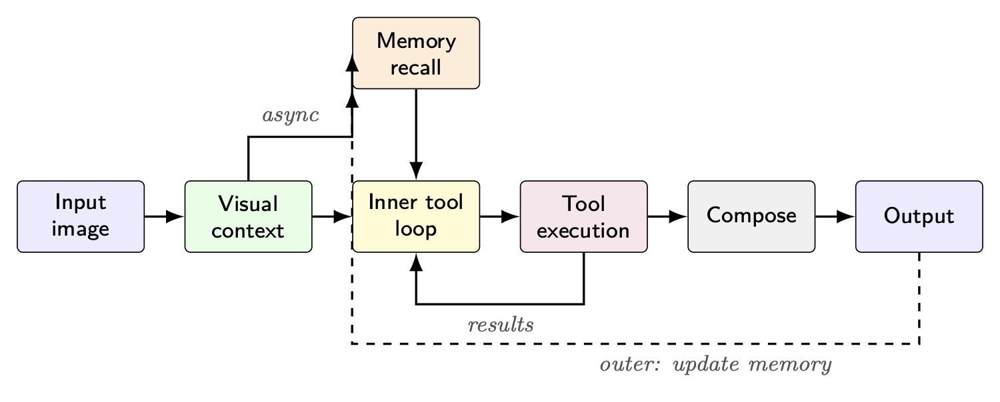
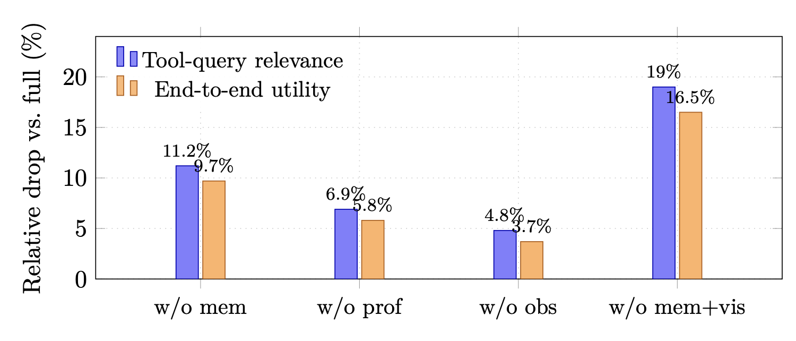

<div align="center">
  <h1>Memory-Conditioned Tool Calling for Camera-First Visual Agents</h1>
  <p><sub><code>memory-conditioned-tool-calling</code> · <a href="https://www.chance.vision">Chance AI</a> · arXiv:2607.09822 (v1, 2026-07-10) · 3 figures · 4 tables</sub></p>
  <p><em>Recognition tells an agent what is in an image; personal memory affects what is worth looking up next.</em></p>
  <p>
    <a href="https://arxiv.org/abs/2607.09822"></a>
    <a href="https://arxiv.org/abs/2607.09822"></a>
    <a href="main.pdf"></a>
    <a href="LICENSE"></a>
    <a href="https://github.com/chancevision/memory-conditioned-tool-calling/actions/workflows/build-pdf.yml"></a>
    <a href="CITATION.cff"></a>
    <a href="https://www.chance.vision"></a>
  </p>
  <p>
    <a href="https://arxiv.org/abs/2607.09822">Paper</a> ·
    <a href="main.pdf">PDF</a> ·
    <a href="#headline-numbers">Headline numbers</a> ·
    <a href="#citation">BibTeX</a> ·
    <a href="#license">License</a> ·
    <a href="https://github.com/chancevision/tastebench">TasteBench paper</a> ·
    <a href="https://github.com/chancevision/camera-first-agents">Camera-First Agents paper</a>
  </p>
</div>

<table>
  <tr>
    <td width="50%" align="center"></td>
    <td width="50%" align="center"></td>
  </tr>
</table>

<sub><em>Left: memory conditions the tool loop rather than sitting on the main pipeline row. Right: ablating the memory layers, relative to the full three-layer condition.</em></sub>

| | |
|---|---|
| **Authors** | Xiaofan Wu (corresponding, equal contribution), Xi Zeng (equal contribution), Miaoxia Chen, Peishan Chen, Shuyan Li, Jiyun Yao, Hanyong Zhong, Jiahao Zhu · [Chance AI](https://www.chance.vision) |
| **Status** | arXiv preprint — not peer-reviewed |
| **Categories** | `cs.CV` (primary) · cross-list `cs.AI`, `cs.CL`, `cs.HC`, `cs.IR` |
| **Design** | a *three-layer personal visual memory* (profile, short-term focus, observations) loaded each turn to condition an LLM tool-calling loop under camera-first (image-only) intake |
| **Version** | v1 — the source here matches the arXiv e-print |

<a id="headline-numbers"></a>

## 🔍 Headline numbers

Study: 800 de-identified images across 10 categories, each paired with a **synthetic** three-layer memory block; three raters; image, tools, and model held fixed so only the memory condition changes.

| Finding | Measurement |
|---|---|
| **Memory conditions tool choice** | removing the full three-layer block drops tool-query relevance **4.21 → 3.74** (11.2% relative) and end-to-end utility **0.842 → 0.760** (9.7% relative; −0.082 absolute) |
| **Which layer carries it** | dropping *profile* costs −0.049 utility, dropping *observations* costs −0.031; the full block is worth more than either layer alone |
| **Memory plus visual context** | removing memory **and** visual context is the worst condition: relevance −19%, utility −16.5% (−0.139 absolute) |
| **Composition is the largest single factor** | pipeline ablation (utility Δ): composition −0.111, tool loop −0.094, memory −0.082, visual context −0.059, multi-tool −0.037, structured trust −0.030 |
| **Tool-argument quality by family** | image search scores highest (relevance 0.90 / specificity 0.82 / self-contained 0.93); places lowest (0.72 / 0.65 / 0.85) |

## 📄 What this paper does — and does not — claim

**Does:** formalizes memory-conditioned tool calling for camera-first agents; specifies a three-layer
personal visual memory with conflict-aware write-back; measures, under fixed synthetic memory blocks,
how much the memory block changes agent-side tool queries, tool arguments, and end-to-end utility;
reports layer-wise and pipeline-component ablations; and describes architecture, memory schema,
protocol, and rubrics in enough detail to support re-implementation.

**Does not:** measure quality of automatic memory formation from live users, multi-session write-back
compounding, or degradation under deliberately mismatched memory blocks. Memory blocks are synthetic
stand-ins, not extracts from real user histories; the images are de-identified evaluation assets, not
production streams; ratings are means of three interface-familiar raters with no inter-annotator
agreement statistic and no per-item variance. The design does not isolate short-term-focus-only
ablations, and write-back across captures is reported as intended design rather than a measured
effect.

The paper describes the architecture, memory schema, ablation protocol, and rating rubrics in
enough detail that the experiments can be read and re-implemented without the internal stack.
This repository carries the manuscript source and the compiled PDF.

## 📰 News

- **2026-10-15** — manuscript source published here; the PDF builds in CI on every push.
- **2026-07-10** — arXiv v1 posted.

## 📦 Contents

```
main.tex      manuscript source (identical to the arXiv e-print)
main.pdf      compiled from this source
assets/       PNG previews of two figures for this page
```

Self-contained: the three figures are TikZ/pgfplots compiled from the same source, and the references
are inline in the file, so the single `.tex` reproduces the whole PDF.

## 🚀 Build

```bash
latexmk -pdf -interaction=nonstopmode main.tex   # pdflatex, as used by arXiv
# or:
tectonic -X compile main.tex
```

CI rebuilds the PDF on every push — see [`.github/workflows/build-pdf.yml`](.github/workflows/build-pdf.yml).

<a id="citation"></a>

## 📚 Citation

```bibtex
@misc{wu2026memoryconditioned,
  title         = {Memory-Conditioned Tool Calling for Camera-First Visual Agents},
  author        = {Wu, Xiaofan and Zeng, Xi and Chen, Miaoxia and Chen, Peishan and Li, Shuyan and Yao, Jiyun and Zhong, Hanyong and Zhu, Jiahao},
  year          = {2026},
  eprint        = {2607.09822},
  archivePrefix = {arXiv},
  primaryClass  = {cs.CV},
  url           = {https://arxiv.org/abs/2607.09822}
}
```

Machine-readable metadata: [`CITATION.cff`](CITATION.cff) (GitHub's **Cite this repository**).

<a id="license"></a>

## ⚖️ License

- **Manuscript, PDF, figures** — [CC BY 4.0](https://creativecommons.org/licenses/by/4.0/): share and adapt with attribution (cite the arXiv version).
- The arXiv record itself remains under [arXiv's non-exclusive license 1.0](https://arxiv.org/licenses/nonexclusive-distrib/1.0/).

**Excluded from the grant:** the 800 evaluation images and the production implementation described
but not released by the paper. See [`LICENSING.md`](LICENSING.md); full CC BY text in [`LICENSE`](LICENSE).
